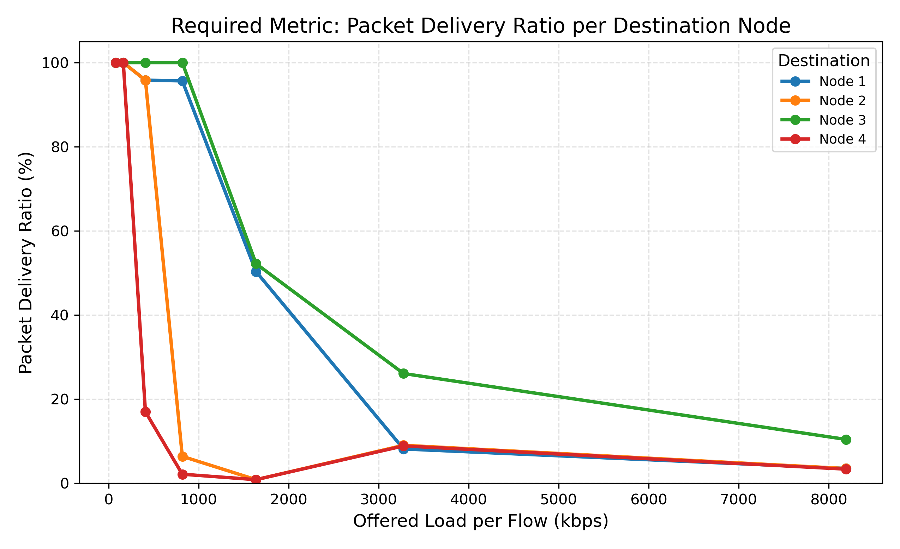
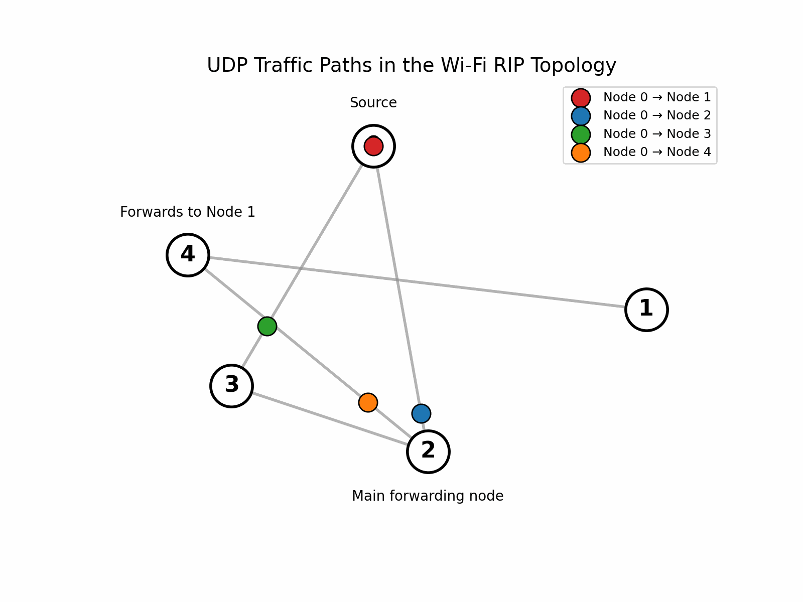

# Wireless Ad Hoc Network Performance with RIP (ns-3)

**Course project · Communication Networks · C++ / ns-3 / Python**

A five-node IEEE 802.11b wireless ad hoc network built in **ns-3** to study how offered traffic load and multi-hop routing affect packet delivery. The simulation uses **RIP** for IPv4 routing, four UDP flows from a common source, FlowMonitor metrics, and NetAnim output. Python scripts analyze the exported CSV data and visualize the topology.



## What I implemented

- Five stationary Wi-Fi nodes with link-specific point-to-point wireless subnetworks and RIP routing.
- Four UDP destinations reached through paths of different lengths; traffic intensity controlled by packet interval.
- Per-flow throughput, end-to-end delay, packet delivery ratio (PDR), and packet loss reporting.
- CSV/XML output, postprocessing plots, and a separate illustrative GIF animation of the configured traffic paths.



## Repository contents

| Location | Description |
| --- | --- |
| `wireless_rip_p2/cc_code/wireless_rip_p2.cc` | Main ns-3 simulation |
| `wireless_rip_p2/python_files/plot_results.py` | Reads simulation CSVs and creates figures |
| `wireless_rip_p2/python_files/animate_wireless_rip_topology.py` | Generates a schematic packet animation |
| `wireless_rip_p2/csv_files/` | Previously generated measurements |
| `wireless_rip_p2/final_plots/` | Performance figures and summary tables |
| `wireless_rip_p2/xml_files/` | NetAnim and FlowMonitor XML |
| `docs/report-redacted.pdf` | Original course report (student number removed) |

## Reproduce the simulation

Requires **ns-3 with Wi-Fi, RIP, FlowMonitor, and NetAnim modules**. The exact ns-3 version used for the original run was not recorded, so you may need adjustments for newer versions.

1. Copy `wireless_rip_p2/cc_code/wireless_rip_p2.cc` into the `scratch/` directory of your ns-3 installation.
2. From the ns-3 project directory, run (example):

   ```bash
   ./ns3 run 'scratch/wireless_rip_p2 --packetInterval=0.01'
   ```

3. Repeat using different packet intervals to generate additional CSVs. The supplied analysis dataset includes experiments over several intervals, from `0.001` to `0.1` seconds.
4. Put exported CSV files matching `wireless_rip_p2_results_*.csv` under `wireless_rip_p2/` in this repository. Run:

   ```bash
   python -m pip install -r requirements.txt
   python wireless_rip_p2/python_files/plot_results.py
   ```

   Graphs are written to `wireless_rip_p2/final_plots/`.

## Research observations and limitations

The results let you compare load sensitivity across destinations, the impact of multiple hops, and traffic carried by intermediate nodes. **The `Path`, `HopCount`, and forwarding classifications in the exported CSV are defined by the experiment's intended topology**, rather than dynamically reconstructed from RIP routing logs. The animated paths are explanatory visualizations, not packet-by-packet traces. No new simulation run is claimed in this repository preparation.

**Author:** Sina Hemmati · B.Sc. Electrical Engineering (Telecommunications), K. N. Toosi University of Technology.
